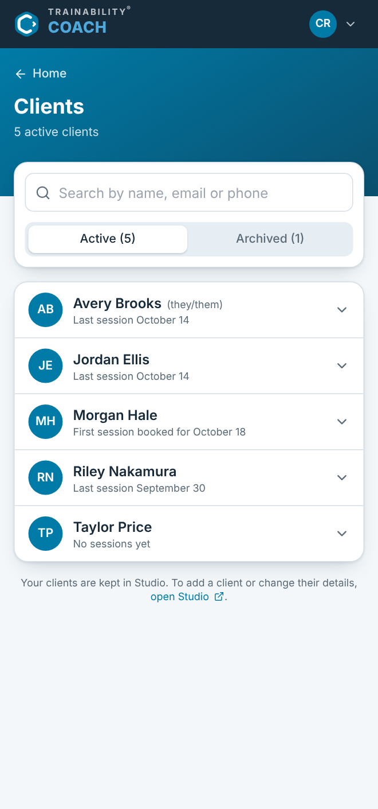
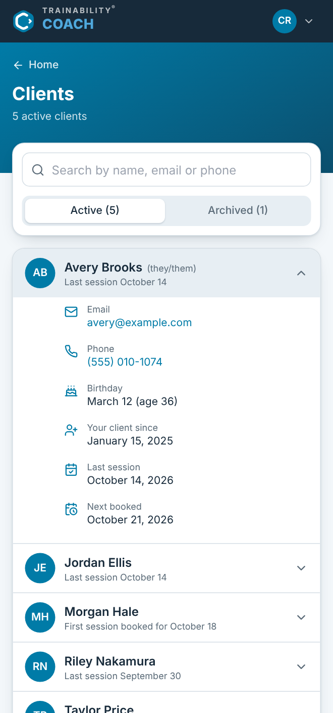

# TRAINABILITY COACH - NEURAL BRAIN

Where finished work from [BRAINSTORM.md](BRAINSTORM.md) is kept, in three parts:

- [Completed brainstorm](#completed-brainstorm): every item that left Next up, with the note on
  how it was done. An item moves here as soon as it is finished.
- [Test Run Fixes](#test-run-fixes): every test run, with what it found and
  how each problem was fixed. Each fix is written up here as soon as it is
  made, under its run.
- [User Manual](#user-manual): a copy of the whole manual, MANUAL.md,
  as it stands now. `npm run manual` refreshes it, and `npm run check-docs`
  fails when it falls behind. Edit MANUAL.md, never the copy.

Nothing is summarised on the way in. The notes arrive exactly as they were
written, because the reason for keeping them is the detail, not the fact that
something happened.

**Newest first**, in the first two parts. New arrivals go on top, so reading
downwards means going backwards in time.

---

# Completed brainstorm

- **Clients: the signed-in trainer's own clients, from Studio** (16 Oct 2026; Glenn: "Well, next, we need to sync clients from Studio to Coach, for the trainer that is logged in on Coach. I'm not sure what we need yet (data wise) but a way to see all your clients and basic information about them to start is good."). Done in the first cloud session, with Studio's repository attached read-only to look at its API; nothing in Studio was changed. **No sync, a live read.** Studio already has `GET /api/clients` (server/index.js, `visibleClients`), scoped to whoever is signed in: a trainer gets their own list (less any they archived who have since moved to another trainer) plus a cut-down copy (`bookingOnly`) of the clients of trainers they book for; staff get their trainers' clients marked `deskOnly`; an admin or master gets everybody they manage. So Coach keeps no copy and nothing can fall out of step: Coach's server gained its own `GET /api/clients` (server/index.js) that asks Studio's `/api/auth/me` and `/api/clients` at once with the same `ts_session` cookie, keeps only clients whose `trainerIds` include this account and that are not `bookingOnly` or `deskOnly` (so a master sees their own list, not the whole business), and maps each to the few fields the screen shows: id, first and last name, email, phone, pronouns, dateOfBirth, `since` (`linkedAt[me]`, the day they joined this trainer's list, falling back to `createdAt`, as Studio's run 6 decided), lastSessionOn, latestSessionOn, `archived` (this trainer is in `archivedBy`) and `sharedWith` (other trainers still active with them). Card, payment method, notes, address, emergency contact, key tag, memberships and message settings never reach the browser. Studio's error answers (a 401 "Not signed in") pass through as they are; an unreachable Studio is the relay's own 502 `studio_unreachable`, now shared with the sign-in relay through a `studio()` fetch helper that both use. Photos were left out: Studio serves them from `/api/photos/client/:id` behind its own sign-in, which would need another relay, so clients show initials. **The screen.** `src/clients/ClientsScreen.jsx`: the navy header, a cerulean band with "← Home", "Clients" and "N active clients", then a card with "Search by name, email or phone" (name, email, or three or more digits of the phone) and Active (n) / Archived (n) tabs, and the list in Studio's order (first name, last name). Each row: initials (grey when archived), name with pronouns in brackets, and "Last session October 14", "First session booked for October 18" (no session yet but one booked; first written as "First session …", which read as past) or "No sessions yet". Tapped, a row opens to Email (mailto), Phone (tel), Birthday with age, Your client since, Last session, Next booked (`latestSessionOn` when it differs from `lastSessionOn`, since Studio's last is up to today and latest is any booked) and, when shared, "Also trains with N other trainer(s)"; one open at a time. Empty, error ("Couldn't reach Trainability. Check your connection and try again." / "Your clients couldn't be loaded. Try again in a minute." with Try again) and no-match states; a footer sends adding or changing a client to Studio. Dates are read as days (`src/clients/format.js`), never shifted by time zone. **Wiring.** No router was added: `src/hooks/usePath.js` reads `location.pathname` and uses `pushState`/`popstate`, so `/clients` is a real address (the server already sends every non-API path the page), and reload and Back work. `App.jsx` gained a `SignedIn` part that holds the list (`src/hooks/useClients.js`) and asks again on every change of screen, keeping the old list on screen meanwhile; a 401 from it calls `useAuth`'s new `signedOut` and returns to sign-in. The home Clients card is now a button with a "5 active clients" pill and a chevron; the other three keep Coming soon. **Tested** in the cloud against a stand-in for Studio's API (a 40-line Node server on port 4242 in the session's scratchpad, made-up people, never committed), because the session cannot run Studio's fixture: Coach's `/api/clients` refused without a session (Studio's 401), dropped another trainer's client and a `bookingOnly` one, and sent none of the card, notes or address; sign-in still set a host-only cookie; in Chromium, a reload on `/clients`, search by phone digits, no-match, the Archived tab, ← Home and Back all worked with no console errors, at phone width and 1200px, light and dark. **Not tested:** against Studio's real fixture API, so the true shape of Studio's records and a real trainer's sign-in still want checking on the Mac. `scripts/screenshots.mjs` takes two more pictures (03-clients, 04-client-details); 02-home, 03 and 04 were taken in the cloud's Chromium with the stand-in's people, so their font differs from 01-login, taken on the Mac; `npm run screenshots` on the Mac against the fixture would make them match. Manual chapter 4 (Your clients, 4.1–4.6) added, Words and When something goes wrong renumbered to 5 and 6 and extended; CHANGELOG bullet under 1.0 Caesious (no version change); README section on the clients relay. Commit `552b428`.

- **CLAUDE.md, so cloud sessions work the same way** (16 Oct 2026; Glenn: "can we create an environment for this project to cloud as well? how would we do that?", then "yes write it"). The account already has one cloud environment, Default, and environments are not tied to a repository, so Coach can run in the cloud as it is. What a cloud session would lack is the method: Claude's memories for Coach (the brainstorm queue, NEURALBRAIN as memory, the one manual, codenames) live on Glenn's Mac, not in the repo, and memsearch is local too. `CLAUDE.md` puts those rules in the repository, where every session reads them: what Coach is and that it keeps no accounts; BRAINSTORM's Next up as the only queue; NEURALBRAIN searched before asking and written to straight away, in full; the manual's rules and its three npm commands; asking Glenn for a minor version's name; never testing against the live Studio. It also says what a cloud session cannot do: it has only this repository, so no Studio fixture and no end-to-end sign-in, and no `server/.env`. Studio has no CLAUDE.md, because its sessions have all been local. For the cloud itself, Glenn's to do: give Claude's GitHub app access to `glennpineda/trainability-coach` if it is limited to selected repositories, and optionally a Coach environment on claude.ai/code (setup script `npm install`, `STUDIO_ORIGIN=http://localhost:4700`).

- **1.0 is "Caesious"** (16 Oct 2026; Glenn: "The codename for this version 1.0 is \"Caesious\""). Carried the way Studio carries "Heliotrope": `package.json` has `"version": "1.0.0"` (it was 0.1.0) and `"codename": "Caesious"`; `vite.config.js` bakes both into the bundle through a `virtual:app-version` module, as Studio's does, and `src/version.js` makes `VERSION_LABEL` ("1.0.0 · Caesious"). It shows under the logo on the sign-in screen, as Studio's "Version 3.1.1437 · Heliotrope" does, and at the foot of the account menu; `/api/health` now returns `version` and `codename` from the same package.json, so the page and its host cannot disagree. A `CHANGELOG.md` in Studio's format opens with "## 1.0 Caesious". The manual says where the version is (2.1, 3.2, and Words). Studio's rule came with it: every minor version gets a name Glenn chooses, asked for before the bump and never invented; build numbers get none. Screenshots retaken, since the sign-in picture now has the version on it.

- **TRUST_PROXY on Airo, and the first real sign-in** (16 Oct 2026; the two Next up items left from going live; Glenn: "Both done: TRUST_PROXY=1 is set on Airo and I signed in to trainabilitycoach.com with my real account; it landed on the home screen with my name."). Both were Glenn's: the setting lives in Airo's dashboard, and a real sign-in needs a real password. `TRUST_PROXY=1` makes Coach's server take the visitor's address from the one proxy GoDaddy puts in front of it (`app.set("trust proxy", 1)` in server/index.js), which is what it now sends Studio as `X-Forwarded-For`. It does not yet change what Studio counts for its per-IP sign-in limit: Studio still sees Coach's server as the caller, which is the open item in Questions. The sign-in is the first end-to-end proof on the live site with a real account: Coach's page, the relay, Studio's live API and MySQL database, Studio's session cookie kept on trainabilitycoach.com, and `/auth/me` returning the right person for the home screen's greeting. Everything before this had been checked against Studio's fixture database locally, or from outside with nobody signed in.

- **The user manual, written the Studio way** (16 Oct 2026; Glenn: "Let's do the same way we write Manuals on Studio as well, but in this, we only have one manual for now (no need to create trainer, quicktstart etc)"). `MANUAL.md`, in Studio's voice: for somebody not comfortable with computers, every task numbered step by step, **tap** meaning click as well, page breaks between chapters so it prints, a table of contents, and the exact words on the buttons and in the messages, checked against the code (Studio's own error texts for archived, locked and too many tries; the 30-day and one-day session lengths from Studio's auth.js). Five chapters for what exists: before you start (one account for every Trainability app, but separate sign-ins), signing in, the home screen, words, and when something goes wrong. Studio's `<!-- only:managers -->` edition markers are left out, since there is one manual. A temporary password is finished in Studio (2.4), because Coach has no screen to choose a new one; changing it there ends Coach's session too, as Studio ends every other session on a password change, so the box goes once you sign in again. Tooling copied from Studio and cut down: `npm run screenshots` (puppeteer-core with the installed Chrome, phone size 440×940 at 1.5×, light mode, reduced motion so the hexagons hold still, CPU rasteriser; signs in with `SHOT_EMAIL` and `SHOT_PASSWORD` from `server/.env`, the fixture account) takes `docs/images/01-login.png` and `02-home.png`; `npm run manual` copies MANUAL.md under **# User Manual** at the bottom of this file with every heading one level down, as Studio's `brainWithManual` does; `npm run check-docs` fails if that copy is behind or a pictured file is missing. The home picture's date and greeting change with the day it is taken.

- **BRAINSTORM.md and NEURALBRAIN.md, kept the Studio way** (16 Oct 2026; Glenn: "model the same brainstorm.md and neuralbrain.md here as well, same as Studio, same methods and storing information like it does at Studio"). Both files copy Studio's headers and sections word for word where the words still fit: BRAINSTORM has Next up (the queue), Found in testing, Ideas, Questions and Parked; this file has Completed brainstorm, Test Run Fixes and User Manual, newest first. Seeded from the day's work rather than left empty: the two things still open on the live site went into Next up, the home screen's four placeholders, single sign-on, the wordmark font and Studio's look into Ideas, the shared per-IP sign-in budget into Questions, and the abandoned `/coach` plan into Parked. Studio's method also lives in two Claude memories, `brainstorm-queue` and `neuralbrain-is-memory`; Coach got its own copies in its project memory, and this file is indexed into memsearch's Coach collection (`ms_trainabilitycoach1_a681c7ef`) as Studio's is into its own. Coach has no manual yet, so User Manual says so rather than holding a copy, and there is no `trainer-manual`-style script to refresh it.

- **Coach live on GoDaddy at trainabilitycoach.com** (16 Oct 2026; Glenn: "app is created on GoDaddy, and trainabilitycoach.com is connected as the apps domain"). Checked from outside: `/api/health` answers on both `trainabilitycoach.com` and `www.` with `"studio":"https://www.trainabilitystudio.com"`, the page and a deep link (`/clients`) both return 200, and `/api/auth/me` comes back with Studio's own `{"error":"Not signed in"}`, so the relay reaches Studio's API. Glenn asked whether `STUDIO_ORIGIN` takes several addresses ("https://www.xxx.com, https://xxx.com etc"): one only, since it is the single address Coach calls rather than a list of allowed ones, and it must be one that answers without a redirect because the relay uses `redirect: "manual"` and would hand a 301 back as the answer. Both Studio addresses answered 200, and Glenn had set the `www.` one. Still open (Next up): `TRUST_PROXY=1`, and a sign-in with a real account.

- **The local .env, in server/ as in Studio** (16 Oct 2026; Glenn: "where is our local .env? I liked having that on Studio so I can reference back to it", then "yeah, we have .env in the server/ folder"). There was none: only `.env.example`, and the server read nothing from disk. Now `server/.env` holds the local settings (`STUDIO_ORIGIN=http://localhost:4700`, `PORT=4800`), the fixture test account, and the live Airo settings for reference. `server/index.js` loads it with Node's own `process.loadEnvFile`, found from the file's location rather than the working directory, and checked first that it never overrides a variable already set, so Airo's settings win over a stray file. It went to the repo root first and moved to `server/` on Glenn's word; `.gitignore`'s `.env*` keeps it out of git either way. The test account's password moved out of `.env.example`; it is still in the first commit on GitHub, which is harmless since that account exists only in Studio's throwaway fixture database. Commits `0dfc5af`, `2531546`.

- **Its own repository: glennpineda/trainability-coach** (16 Oct 2026; Glenn: "can we use a different repo?", then "commit only, I have a private repo ready"). The first plan had Coach built into Studio's repo and served at `/coach` on Studio's domain, sharing Studio's session cookie; Studio runs on GoDaddy Airo as one Node process whose catch-all sends every non-`/api` path to Studio's own `index.html`, so it would have needed a route added to Studio. With a repository of its own, Coach needed a server of its own instead: `server/index.js` serves the built page and relays exactly four routes to Studio's API (`/api/auth/login`, `/me`, `/logout`, `/forgot-password`); anything else under `/api` is a JSON 404. Only Studio's `ts_session` cookie is passed upstream, and Studio's `Set-Cookie` comes back with any `Domain` stripped, so the session belongs to Coach's domain alone. Same email and password as Studio, separate sessions: the copy that said "logging out here logs you out of Studio too" came out. Known limit, now in Questions: Studio's per-IP sign-in budget is shared by everyone coming through Coach. `vite.config.js` lost its `/coach/` base and now proxies `/api` to Coach's server on 4800 in development. `package.json` moved the build tools into dependencies, as Studio has them, because Airo's `npm start` builds after a plain install. The push was first refused: GitHub's starter commit held only a README reading "# trainability-coach", so it was merged in (`--allow-unrelated-histories`, keeping Coach's README) rather than force-pushed. Commits `1c55d2f`, then the merge `d5b87c9`.

- **TRAINABILITY® instead of ™** (16 Oct 2026; Glenn: "can you change the TM on the Trainability wordmark to a (R) registered trademark"). The wordmark in the lockup SVGs is outlines, not text, so there was no character to swap: one path of 19 shapes, the last two being the T and M. Those two came out, and the ® was built from the wordmark's own R (shapes 1 and 2) scaled into a ring 0.555 of the cap height across, so it matches the letterforms exactly. The ® is narrower than the ™ was, so the whole word moved 7.67 units right to stay centred. Same geometry in all three lockups (light, dark, dark on navy), so one script did all three; the PNGs (600, 1500 and 3000 wide, and 1500 on navy) were re-rendered from the new SVGs with headless Chrome at their original sizes on a transparent background. The header's own TRAINABILITY text got a ® too, pulled in by `-0.1em` because the letter spacing left it floating. `brand/README.txt` now says TRAINABILITY(R) COACH.

- **The sign-in and home screens** (16 Oct 2026; Glenn: "Let's start building the design of this app, modeled after Trainability Studio as they are going to be hosted at the same place, GoDaddy. Authentication (login) should be universal for all Trainability apps, so the e-mail/password used at Studio should work for Coach as well. The main color is cerulean. I attached the logo kit. Let's just start basic, with just having the login screen and the home screen."). Studio's own stack, so pieces can move between the two: React 18, Vite 5, Tailwind 3, lucide icons. Colors from the logo kit: Cerulean `#007BA7` for buttons and the sign-in wash, Sky `#4FA8DC` for COACH and links on dark, Navy `#172A3A` for the header and words; set once as tokens in `src/index.css` under Studio's names, with a dark version (navy ground, sky links, since cerulean is too dark to read on navy). The sign-in screen follows Studio's: a cerulean-to-navy gradient, three of the badge's rounded hexagons drifting out of step behind it (still when the device asks for less motion), a white card with the lockup, "Keep me logged in", "Forgot password?" asking Studio to email a temporary password, and the "came over from the old app" notice when Studio answers `password_migrated`. Like Studio, a name typed without an @ becomes a trainabilitystudio.com address. One screen with both boxes rather than Studio's email-first door, because Studio's door sends clients to a code sign-in Coach does not have. The home screen: a navy header with the badge and an account menu (name, email, role, Open Studio, Log out), a cerulean band with the date and "Good afternoon, Casey", then four placeholder cards (now in Ideas), plus a notice to choose a password in Studio when signed in with a temporary one. Tested against Studio's throwaway fixture API (`npm run fixture`, port 4700) because port 4242 was held by another Studio dev server on its own temp database, which was left alone: a wrong password showed Studio's own "That email and password don't match.", the right one landed on home, a reload stayed signed in, and Log out returned to sign-in. Checked at phone width and in dark mode.

---

# Test Run Fixes

Every full or scoped test run of the app, newest first: how it was tested,
what it found, and how each problem was fixed. A new run gets its own heading
at the top of this section when it starts, and each fix is written up under it
as soon as it is made. Problems not yet fixed wait in BRAINSTORM.md under
**Found in testing**. There are no separate test-run documents; this is the
one place they live.

No runs yet. The first one should write its method in full under its own
heading (how the app was tested, and how to run another), as Studio's run 1
does, so later runs can point back to it.

---

# User Manual

## Trainability Coach
### User manual

Everything you need to use the app, one task at a time.

You do not need to know anything about computers to use this manual. Every task
is written out step by step. Where a step says **tap**, you can also click with a
mouse — they mean the same thing here.

Coach is new, and so is this manual. It covers what the app does today:
signing in, the home screen and your list of clients. Each new part of the
app gets its own chapter here as it arrives.

---

#### Contents

1. [Before you start](#1-before-you-start)
2. [Signing in](#2-signing-in)
   - [2.1 Signing in](#21-signing-in)
   - [2.2 Staying signed in](#22-staying-signed-in)
   - [2.3 If you have forgotten your password](#23-if-you-have-forgotten-your-password)
   - [2.4 Signed in with a temporary password](#24-signed-in-with-a-temporary-password)
   - [2.5 Signing out](#25-signing-out)
3. [The home screen](#3-the-home-screen)
   - [3.1 Reading the screen](#31-reading-the-screen)
   - [3.2 Your account menu](#32-your-account-menu)
   - [3.3 Going to Studio](#33-going-to-studio)
   - [3.4 Light or dark](#34-light-or-dark)
4. [Your clients](#4-your-clients)
   - [4.1 Opening your clients](#41-opening-your-clients)
   - [4.2 Reading the list](#42-reading-the-list)
   - [4.3 Seeing a client's details](#43-seeing-a-clients-details)
   - [4.4 Finding a client](#44-finding-a-client)
   - [4.5 Archived clients](#45-archived-clients)
   - [4.6 Adding or changing a client](#46-adding-or-changing-a-client)
5. [Words this app uses](#5-words-this-app-uses)
6. [When something goes wrong](#6-when-something-goes-wrong)

---

### 1. Before you start

#### What this app is for

Trainability Coach is the coaching app in the Trainability family, alongside
**Trainability Studio**, the app the business runs its schedule and billing
in. Coach is where your coaching will live: your day, your clients, the
programs you build for them, and your messages with them. Your list of
clients is here already (chapter 4); the other parts are still being built —
the home screen shows them as **Coming soon** (3.1).

#### One account for every Trainability app

You do not need a new account for Coach. **The email and password you use for
Trainability Studio work here too.** There is only one list of accounts, kept
by Studio, so:

- If you change your password, it changes for both apps.
- If you are sent a temporary password, it works in both.
- If your account is archived or locked in Studio, it cannot sign in to Coach
  either.

> **Signed in to one is not signed in to the other.** The password is shared,
> but each app keeps its own sign-in. Signing in to Coach does not sign you in
> to Studio in another tab, and signing out of one leaves the other as it was.

#### What you need

- The email address you use for Trainability Studio.
- Your Studio password.
- A web browser on your phone, tablet or computer. Coach is at
  **trainabilitycoach.com**.

---

### 2. Signing in

#### 2.1 Signing in

*The sign-in screen*

1. Open **trainabilitycoach.com** in your web browser.
2. You will see a white box in the middle of a blue screen, with the Coach
   logo at the top: a hexagon with a **C** in it, and **TRAINABILITY®** and
   **COACH** underneath. Under the logo is the version the app is on — for
   example *Version 1.0.0 · Caesious* — and then *Use the same email and
   password as Trainability Studio.*
3. Tap the **Email** box and type your email address. With a
   @trainabilitystudio.com address you can type just the part before the @ —
   the app adds the rest when you log in.
4. Tap the **Password** box and type your password.
5. If this is your own phone or computer, tick **Keep me logged in**. Leave it
   unticked on a shared machine — see 2.2.
6. Tap the blue **Log in** button. It says **Signing in…** for a moment while
   the app checks.

You are now signed in, and you land on the home screen (chapter 3).

If the email and password do not match, the box says *That email and password
don't match.* in red under **Keep me logged in**, and nothing else happens.
Check both and try again. The message is the same whether the email or the
password is wrong — it will not tell a stranger which addresses have an
account.

#### 2.2 Staying signed in

**Keep me logged in** decides what happens the next time you open the app.

| | What happens |
|---|---|
| **Ticked** | You stay signed in for up to 30 days, even after closing the browser. |
| **Not ticked** | You stay signed in until you close the browser, or for a day at most. |

> **On a shared computer, leave it unticked.** Unticked, closing the browser
> signs you out, so the next person to use it cannot open Coach as you.

When you are still signed in, opening Coach goes straight to the home screen.

#### 2.3 If you have forgotten your password

1. On the sign-in screen, tap **Forgot password?** underneath the Log in button.
2. Type your email address into the **Email** box. If you had already typed it
   on the sign-in screen, it is there already.
3. Tap **Send temporary password**. The screen says the same thing whether or
   not that address has an account — it will not tell a stranger who has one —
   and the password itself only ever arrives by email.
4. Check your email. It may take a minute to arrive; look in the junk folder
   before trying again, because each try replaces the last password sent.
5. Tap **Back to login** and sign in with the temporary password.

The temporary password works in Coach and in Studio. See 2.4 for what to do
next.

#### 2.4 Signed in with a temporary password

A temporary password is meant to be used once and then replaced with your own.
When you sign in to Coach with one, the home screen shows a box at the top:
*You're signed in with a temporary password.*

1. Tap **Studio** in that box. Studio opens.
2. Sign in to Studio with the same temporary password.
3. Studio asks you to choose your own password. Type it into **New password**
   and again into **Confirm new password** — at least 8 characters — and tap
   **Set password & continue**.

Your new password now works in both apps. The box in Coach goes away the next
time you sign in to Coach.

> **An account that came over from the old app.** If your account was moved
> across from the old Trainability app and has not been given a password yet,
> trying to sign in shows **Check your email.** instead of an error, and a
> temporary password is sent to that address. Sign in with it, then follow the
> steps above.

#### 2.5 Signing out

1. Tap your initials (or your photo) in the top right corner.
2. Tap **Log out**.

You are back on the sign-in screen. Signing out of Coach does not sign you out
of Studio.

---

### 3. The home screen

#### 3.1 Reading the screen

*The home screen*

From top to bottom:

- **The dark bar across the top.** The Coach logo and the words
  **TRAINABILITY® COACH** on the left; your initials (or your photo) on the
  right, which opens your account menu (3.2).
- **The blue band.** Today's date, and a greeting with your first name:
  **Good morning** until noon, **Good afternoon** until 5 PM, and
  **Good evening** after that.
- **Four cards**, one for each part of Coach:

| Card | What it is for |
|---|---|
| **Today** | Your sessions for the day, at a glance. |
| **Clients** | Everyone you coach, with their contact details and sessions. |
| **Programs** | Workouts and plans you build and assign. |
| **Messages** | Check-ins and notes between you and your clients. |

**Clients** is ready: next to its name it says how many clients you have,
such as **5 active clients**, and tapping it opens your list (chapter 4).
The other three are marked **Coming soon**, and tapping them does nothing
yet.

#### 3.2 Your account menu

1. Tap your initials (or your photo) in the top right corner.
2. A small panel opens with your name, your email address and what kind of
   account you have: **Trainer**, **Admin**, **Master** or **Front desk** —
   the same as in Studio.
3. Under that are **Open Studio** (3.3) and **Log out** (2.5).
4. The last line is the version the app is on, such as
   *Version 1.0.0 · Caesious*. If you ever report a problem, say which
   version it was.

To close the panel without choosing anything, tap anywhere outside it, or
press Esc on a keyboard.

#### 3.3 Going to Studio

Tap your initials, then **Open Studio**. Studio opens at
trainabilitystudio.com. If you are not signed in there, sign in with the same
email and password.

You can also get there from the sign-in screen: **Open Studio** is under the
white box, after *Part of the Trainability family*.

#### 3.4 Light or dark

Coach follows your phone or computer. If your device is set to dark mode,
Coach is dark too — a navy background with white and light blue words —
and light otherwise. There is nothing to set in the app.

---

### 4. Your clients

Coach shows the clients on your own list in Studio — the same people you see
under your name there. It reads them from Studio every time, so anything
changed in Studio shows in Coach the next time you open the list. Coach keeps
no copy of its own.

#### 4.1 Opening your clients

1. On the home screen, tap the **Clients** card.
2. The **Clients** screen opens. Under the word **Clients** it says how many
   active clients you have.

To go back, tap **← Home** above the word **Clients**, or use your browser's
back button.

#### 4.2 Reading the list

*Your clients*

Each client has one line, in order of first name:

- **A circle with their initials.**
- **Their name.** If they have told Studio their pronouns, those are next to
  the name in brackets, such as *(they/them)*.
- **One line about their sessions:**

| It says | What it means |
|---|---|
| **Last session October 14** | The last session they had, with you or another trainer. |
| **First session booked for October 18** | They have not had a session yet, but one is booked. |
| **No sessions yet** | Nothing has happened and nothing is booked. |

If you have no clients yet, the list says *You have no clients yet. Clients
you add in Studio show here.*

#### 4.3 Seeing a client's details

*A client's details, opened*

1. Tap the client's line. It opens underneath to show:

| Detail | What it shows |
|---|---|
| **Email** | Their email address. Tap it to write to them. |
| **Phone** | Their phone number. Tap it to call them from a phone. |
| **Birthday** | The day, and how old they are now, such as *March 12 (age 36)*. |
| **Your client since** | The day they joined your list. |
| **Last session** | The last session they had. |
| **Next booked** | The next session booked for them, or *Nothing booked*. |
| **Shared** | Only for a client who also trains with somebody else: *Also trains with 1 other trainer*. |

   Anything Studio does not have says **Not given**, **Not known**,
   **None yet** or **Nothing booked**.
2. Tap the line again to close it. Opening another client closes the first.

#### 4.4 Finding a client

1. Tap the box that says **Search by name, email or phone**.
2. Type part of their name, their email, or at least three digits of their
   phone number. The list shrinks to the people who match as you type.
3. To see everybody again, empty the box.

If nobody matches, the list says *No one matches* and what you typed.

#### 4.5 Archived clients

Clients you have archived in Studio — people you no longer train — are kept
apart from the rest.

1. Tap **Archived** next to the search box. The number in brackets is how
   many there are.
2. The list now shows only your archived clients, with grey circles. Tapping
   one shows the same details as in 4.3.
3. Tap **Active** to go back to the people you are training.

#### 4.6 Adding or changing a client

Clients are added, changed and archived in **Studio**, not in Coach. At the
foot of the Clients screen it says *Your clients are kept in Studio. To add a
client or change their details, open Studio.*

1. Tap **open Studio**. Studio opens.
2. Make the change there.
3. Come back to Coach and open **Clients** again. The change is there.

---

### 5. Words this app uses

| Word | What it means |
|---|---|
| **Coach** | This app, Trainability Coach, at trainabilitycoach.com. |
| **Studio** | Trainability Studio, the business's scheduling and billing app, at trainabilitystudio.com. Your account lives there. |
| **Temporary password** | A password emailed to you when yours is reset or forgotten. Use it once, then choose your own in Studio (2.4). |
| **Keep me logged in** | The tick box that keeps you signed in for up to 30 days on this device (2.2). |
| **Coming soon** | A part of Coach that is planned but not built yet. |
| **Active client** | A client on your list who you are still training. |
| **Archived client** | A client you have archived in Studio because you no longer train them. They are under **Archived** on the Clients screen (4.5). |
| **Version** | Which release of Coach you are using: a number such as 1.0.0, and the release's name, such as Caesious. Shown on the sign-in screen and in your account menu. |

---

### 6. When something goes wrong

**"That email and password don't match."**
One of them is wrong. Check the email for a typing mistake, and that Caps Lock
is off for the password. It is the same password as Studio — if it works there,
it works here. If you cannot remember it, use **Forgot password?** (2.3).

**"Too many failed sign-in attempts. Try again in … minutes."**
After several wrong passwords in a row, signing in is paused for a few
minutes to stop anybody guessing. Wait the number of minutes it says, then try
again — or use **Forgot password?** (2.3) instead of guessing.

**"This account has been archived. Ask a manager to restore it."**
Your account was archived in Studio, usually because you no longer work there.
A manager can restore it in Studio; until then it cannot sign in to either app.

**"This account is locked. Ask a manager to unlock it."**
A manager has locked the account in Studio. Ask them to unlock it.

**"Trainability isn't answering right now, so signing in may not work."**
This appears at the top of the sign-in box when Coach cannot reach Studio,
where accounts are kept. It is not something you did. Wait a minute and reload
the page.

**"Couldn't reach Trainability. Check your connection and try again."**
The sign-in, or your list of clients, did not get through. Check that your
phone or computer is connected to the internet, then tap **Log in** again —
or, on the Clients screen, **Try again**.

**"Your clients couldn't be loaded. Try again in a minute."**
Studio answered, but not with your list. Wait a minute and tap **Try again**.
If it keeps happening, tell whoever looks after the app.

**A client is missing from your list.**
Coach shows the clients on your own list in Studio. Check that they are under
your name in Studio, and not archived — an archived client is under
**Archived** (4.5).

**You are back on the sign-in screen.**
Your sign-in ran out while the app was open. Sign in again (2.1).

**The temporary password email never came.**
Look in the junk or spam folder first. Each request replaces the last password
sent, so use only the newest email. If nothing arrives after a few minutes,
make sure the address is the one you use for Studio.
